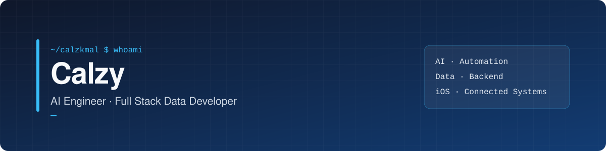

  

  <strong>AI Engineer &amp; Full Stack Data Developer</strong> 
  Building AI workflows and data-driven products from source to interface.

  

  
  
  

---

### 👋 About me

I'm **Calzy**, focused on AI engineering and full stack data development. I enjoy connecting the pieces of a data-driven product: gathering and validating data, designing backend workflows, and building interfaces that make the results useful.

- 🤖 **AI & automation:** building AI-assisted workflows with attention to source material, review, and validation.
- 🗄️ **Full stack data:** working across data ingestion, quality, backend integration, and user-facing applications.
- 🌊 **Connected systems:** exploring environmental and sensor data, with care for provenance and how measurements are presented.
- 📱 **Product development:** building native interfaces with SwiftUI and connecting them to data and services.
- 🏃 **Outside the editor:** running and planning my next trail.

---

### 🧰 Tech stack

  
  

---

### 🚀 Featured projects

| Project | What it does | Stack |
| :-- | :-- | :-- |
| [**SEAGIS**](https://github.com/De-Voeux) | A team project developing an iOS app to help seaweed farming community advocates understand environmental conditions relevant to cultivation, using sensor observations and regional data. | SwiftUI · MapKit · PostgreSQL · Supabase · IoT |
| [**Catch the Scott**](https://github.com/K-ere-Horee/CtSPoC) 🔒 | A 3D iOS fishing game prototype with a physical controller, real-time water visuals, and haptic feedback. Repository is private. | RealityKit · CoreMotion · CoreHaptics · Bluetooth |
| [**EMODU**](https://github.com/calzkmal/emodu-llm-app) | An API that uses a language model to generate short, emotion-aware motivational messages for students. | Python · FastAPI · Ollama |
| [**Fluxync**](https://github.com/calzkmal/fluxync-model) | A binary image-classification model for NSFW content, developed with convolutional neural networks and MobileNetV2. | Python · TensorFlow · Keras |
| **AI Content Pipeline** | An automation workflow for a finance company client that drafts market-update articles from research, with review and validation. | n8n · AI · Google Docs · Supabase |

> SEAGIS is a team project under development. Some paths use synthetic data; production integration and scientific validation are ongoing.

---

### 📈 GitHub activity

  

  

---

### 📫 Let's connect

Always happy to exchange ideas about AI engineering, data-driven products, automation, and environmental technology.

**LinkedIn:** [linkedin.com/in/calzkmal](https://www.linkedin.com/in/calzkmal/) · **Email:** [calzkmal@gmail.com](mailto:calzkmal@gmail.com)
